  

  <a href="https://sundram-rai.vercel.app/">PORTFOLIO ↗</a>
  &nbsp; · &nbsp;
  <a href="https://www.linkedin.com/in/sundram-rai3961">LINKEDIN ↗</a>
  &nbsp; · &nbsp;
  <a href="mailto:sundramrai4687@gmail.com">EMAIL ↗</a>
  &nbsp; · &nbsp;
  <a href="https://github.com/Sundramrai3691?tab=repositories">REPOSITORIES ↗</a>

<code>NIT RAIPUR</code> &nbsp; / &nbsp; <code>ELECTRICAL ENGINEERING</code> &nbsp; / &nbsp; <code>CLASS OF 2027</code>

## 00 / The through-line

I build **backend-heavy products, real-time developer tools, and applied AI systems**. The interesting work starts after the demo: concurrency, validation, retries, idempotency, auditability, and performance you can measure.

Currently moving between **distributed application engineering** and **AI systems that behave predictably**.

## 01 / Three things made real

<table>
  <tr>
    <td width="50%" valign="top">
      
01 — REAL-TIME / DEVELOPER TOOLS

      <h3><a href="https://github.com/Sundramrai3691/ForkSpace">ForkSpace ↗</a></h3>
      A collaborative coding and interview workspace where multiple people can edit together, run code, and validate solutions in one session.
        
      <strong>The engineering:</strong> Socket.IO collaboration, RBAC, hidden-test validation, deterministic stdin generation, multi-language execution, and a Redis token-bucket limiter using atomic Lua scripts.
        
      React · Node.js · Express · Socket.IO · MongoDB · Redis · Docker · Azure
    </td>
    <td width="50%" valign="top">
      
02 — APPLIED AI / LEARNING SYSTEMS

      <h3><a href="https://github.com/Sundramrai3691/RecallLoop">RecallLoop ↗</a></h3>
      An adaptive learning platform built around what a learner can reliably recall and apply, not how long a tab stayed open.
        
      <strong>The engineering:</strong> RAG with pgvector, rubric-based evaluation, structured AI outputs, asynchronous Redis-backed jobs, retries, idempotency, and agentic tool workflows.
        
      React · TypeScript · Node.js · PostgreSQL · Redis · RAG · pgvector · FSRS
    </td>
  </tr>
  <tr>
    <td colspan="2" valign="top">
      
03 — DOCUMENT AI / RELIABLE PIPELINES

      <h3><a href="https://github.com/Sundramrai3691/ReXcan">ReXcan ↗</a></h3>
      An invoice extraction and validation pipeline combining PDF parsing, OCR, and an LLM fallback. Duplicate detection, arithmetic checks, audit trails, asynchronous processing, and a human-in-the-loop review interface turn extraction into a workflow people can verify.
        
      FastAPI · Python · pdfplumber · EasyOCR · Tesseract · LLMs · BullMQ · Redis · React · Jest
    </td>
  </tr>
</table>

## 02 / Numbers with a codebase behind them

<table width="100%">
  <tr>
    <td align="center" width="25%"><h2>17.3 ms</h2>COLLABORATIVE EDIT LATENCY</td>
    <td align="center" width="25%"><h2>86%</h2>INVOICE EXTRACTION ACCURACY</td>
    <td align="center" width="25%"><h2>2.56/s</h2>INVOICES PROCESSED</td>
    <td align="center" width="25%"><h2>10+</h2>MERGED OPEN-SOURCE PRs</td>
  </tr>
</table>

Reported project measurements; see the linked repositories for implementation context.

## 03 / Systems with guardrails

**PeopleOps Copilot** · Project Lead, Innovation Cell, NIT Raipur · *May–August 2026*

Built an agentic employee assistant for HR policy and workforce workflows with LangGraph, FastAPI, and MCP. Implemented natural-language-to-SQL analytics with role-based access control, query validation, human approval for sensitive actions, structured outputs, and PostgreSQL-backed audit logging.

## 04 / My working set

| Layer | Tools I use to build it |
|---|---|
| **Languages & fundamentals** | C++, C, Python, JavaScript, TypeScript · DSA, OOP, OS, DBMS, Computer Networks, concurrency |
| **Backend & data** | Node.js, Express, FastAPI, REST APIs, WebSockets, PostgreSQL, MongoDB, Redis, pgvector |
| **Applied AI** | RAG, LLMs, structured outputs, rubric-based evaluation, AI agents, LangGraph, MCP |
| **Ship & verify** | Docker, GitHub Actions, CI/CD, Jest, Postman, Linux, Azure App Service, Git |

  

## 05 / Signals outside the repo

- **Amazon ML Summer School 2026** — selected from over 1.25 lakh applicants.
- **Competitive programming** — LeetCode Knight (1904); global rank 869 among 30,390 participants in Weekly Contest 469; Codeforces Specialist (1406); CodeChef 3★ (1731).
- **Open source** — 10+ merged PRs through GSSoC ’25 and Hacktoberfest ’25, including testing, CI/CD, accessibility, and frontend improvements.
- **Early-stage building** — ₹25,000 seed grant for an ML-based pet-health startup concept with anomaly detection.
- **Problem solving** — 1,500+ DSA problems solved across platforms.

## 06 / Contribution constellation

  <picture>
    <source media="(prefers-color-scheme: dark)" srcset="https://raw.githubusercontent.com/Sundramrai3691/Sundramrai3691/output/github-snake-dark.svg" />
    <source media="(prefers-color-scheme: light)" srcset="https://raw.githubusercontent.com/Sundramrai3691/Sundramrai3691/output/github-snake.svg" />
    
  </picture>

  Interested in backend engineering, developer tooling, and AI systems that can be tested, measured, and trusted.

