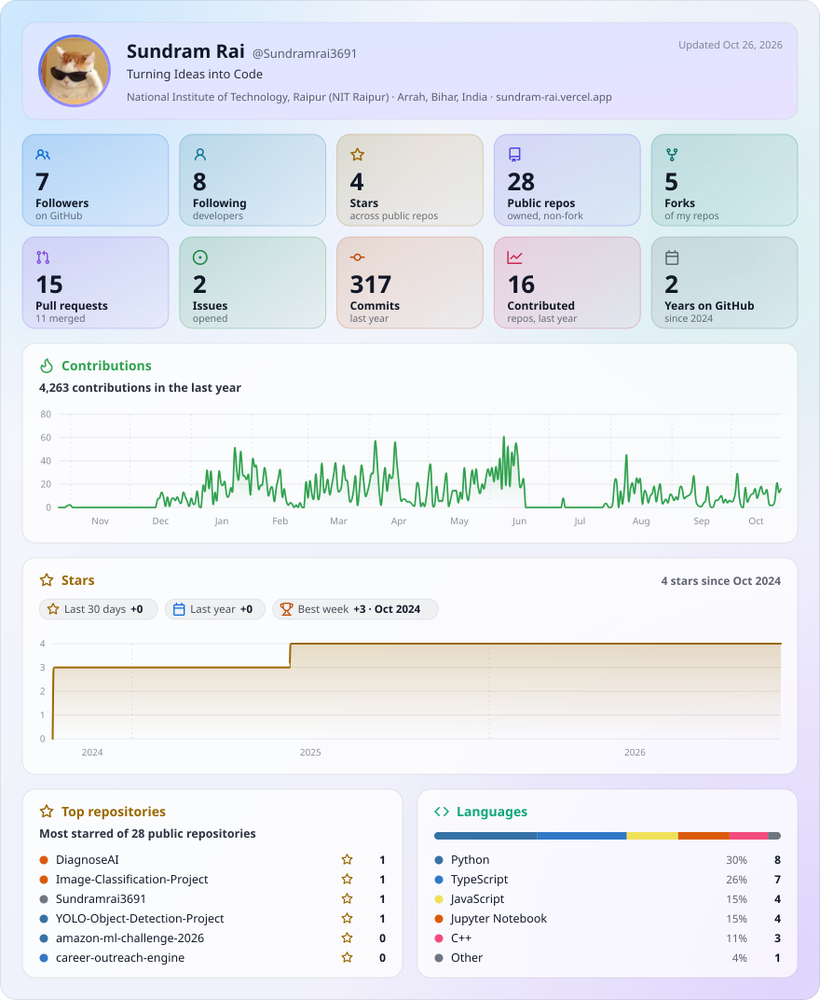

  

  <a href="https://sundram-rai.vercel.app/">PORTFOLIO ↗</a>
  &nbsp; · &nbsp;
  <a href="https://www.linkedin.com/in/sundram-rai3961">LINKEDIN ↗</a>
  &nbsp; · &nbsp;
  <a href="mailto:sundramrai4687@gmail.com">EMAIL ↗</a>
  &nbsp; · &nbsp;
  <a href="https://github.com/Sundramrai3691?tab=repositories">REPOSITORIES ↗</a>

<code>NIT RAIPUR</code> &nbsp; / &nbsp; <code>ELECTRICAL ENGINEERING</code> &nbsp; / &nbsp; <code>CLASS OF 2027</code>

## 00 / The through-line

I build **backend-heavy products, real-time developer tools, and applied AI systems**. The interesting work starts after the demo: concurrency, validation, retries, idempotency, auditability, and performance you can measure.

Currently moving between **distributed application engineering** and **AI systems that behave predictably**. I like making ambitious ideas useful, and making edge cases regret showing up.

## 01 / The working set

The tools I reach for most, grouped by the work they help me ship.

  

| Layer | Tools & concepts |
|---|---|
| **Languages & fundamentals** | C++, C, Python, JavaScript, TypeScript · DSA, OOP, OS, DBMS, Computer Networks, concurrency |
| **Backend & data** | Node.js, Express, FastAPI, REST APIs, WebSockets, PostgreSQL, MongoDB, Redis |
| **Applied AI** | RAG, LLM integrations, structured outputs, rubric-based evaluation, retrieval, AI agents, LangGraph, MCP |
| **Ship & verify** | Docker, GitHub Actions, CI/CD, Jest, Postman, Linux, Azure App Service, Git |

## 02 / Three things made real

<table>
  <tr>
    <td width="50%" valign="top">
      
01 — REAL-TIME / DEVELOPER TOOLS

      <h3><a href="https://github.com/Sundramrai3691/ForkSpace">ForkSpace ↗</a></h3>
      
 &nbsp; <strong>500+ users</strong>

      A collaborative coding and interview workspace where people can edit together, run code, and validate solutions in one session.
        
      <strong>The engineering:</strong> Socket.IO collaboration, RBAC, hidden-test validation, deterministic stdin generation, multi-language execution, and Redis token-bucket rate limiting with atomic Lua scripts.
        
      <strong>Measured result:</strong> 17.3 ms editing latency.
        
      React · Node.js · Express · Socket.IO · MongoDB · Redis · Docker · Azure
    </td>
    <td width="50%" valign="top">
      
02 — APPLIED AI / LEARNING SYSTEMS

      <h3><a href="https://github.com/Sundramrai3691/RecallLoop">RecallLoop ↗</a></h3>
      

      An adaptive learning platform built around what learners can reliably recall and apply, not how long a tab stayed open.
        
      <strong>The engineering:</strong> learner-state tracking, retrieval-grounded remediation, structured answer evaluation, deterministic review planning, asynchronous Redis-backed jobs, retries, and idempotency.
        
      React · TypeScript · Node.js · PostgreSQL · Redis · RAG · FSRS
    </td>
  </tr>
  <tr>
    <td colspan="2" valign="top">
      
03 — DOCUMENT AI / INDUSTRY-GRADE WORKFLOW DESIGN

      <h3><a href="https://github.com/Sundramrai3691/ReXcan">ReXcan ↗</a></h3>
      
 &nbsp; <strong>86% extraction accuracy</strong> &nbsp; · &nbsp; <strong>2.56 invoices/s</strong>

      An industry-grade invoice-processing workflow designed to turn noisy documents into data people can verify. It combines PDF parsing, layered OCR, selective LLM fallback, field normalization, arithmetic checks, duplicate detection, audit trails, asynchronous processing, and human-in-the-loop review.
        
      <strong>The engineering:</strong> deterministic-first extraction with fallback paths and explicit validation, so low-confidence fields can be reviewed instead of silently trusted.
        
      FastAPI · Python · pdfplumber · EasyOCR · Tesseract · LLMs · BullMQ · Redis · React · Jest
    </td>
  </tr>
  <tr>
    <td colspan="2" valign="top">
      
04 — AGENT WORKFLOWS / SECURITY & AUDITABILITY

      <h3><a href="https://github.com/Sundramrai3691/PeopleOps-Copilot">PeopleOps Copilot ↗</a></h3>
      An employee-operations assistant for HR policy questions and controlled workforce workflows. Role-aware authorization, validated analytics, approval gates for sensitive actions, structured outputs, and audit logging keep the assistant inside explicit boundaries.
        
      Python · FastAPI · LangGraph · MCP · PostgreSQL · RAG · Docker
    </td>
  </tr>
</table>

Stars are live repository badges. Performance figures are project measurements; implementation details and limitations are documented in the linked repositories.

## 03 / Systems with guardrails

**PeopleOps Copilot** · Project Lead, Innovation Cell, NIT Raipur · *May–August 2026*

Built an employee assistant using LangGraph, FastAPI, and MCP for HR policy and workforce workflows. Implemented role-based access control, bounded analytics with query validation, human approval for sensitive actions, structured outputs, and PostgreSQL-backed audit logging.

## 04 / Signals outside the repo

- **Amazon ML Summer School 2026** — selected from over 1.25 lakh applicants.
- **Competitive programming** — LeetCode Knight (1904); global rank 869 among 30,390 participants in Weekly Contest 469; Codeforces Specialist (1406); CodeChef 3★ (1731).
- **Problem solving** — 2,000+ DSA problems solved across platforms.
- **Open source** — 10+ merged PRs through GSSoC ’25 and Hacktoberfest ’25, including testing, CI/CD, accessibility, and frontend improvements.
- **Early-stage building** — ₹25,000 seed grant for an ML-based pet-health startup concept focused on anomaly detection and early monitoring.

## 05 / GitHub, at a glance

A compact profile card for repository stars, contributions, pull requests, and activity. The SVG is generated by GitHub Actions and stored in this repository, so the README does not depend on a public stats API at page-view time.

<picture>
  <source media="(prefers-color-scheme: dark)" srcset="./glancecard/profile-dark.svg" />
  <source media="(prefers-color-scheme: light)" srcset="./glancecard/profile-light.svg" />
  
</picture>

## 06 / Contribution constellation

  <picture>
    <source media="(prefers-color-scheme: dark)" srcset="https://raw.githubusercontent.com/Sundramrai3691/Sundramrai3691/output/github-snake-dark.svg" />
    <source media="(prefers-color-scheme: light)" srcset="https://raw.githubusercontent.com/Sundramrai3691/Sundramrai3691/output/github-snake.svg" />
    
  </picture>

## 07 / Community board

  

  Interested in backend engineering, developer tooling, and AI systems that can be tested, measured, and trusted.

